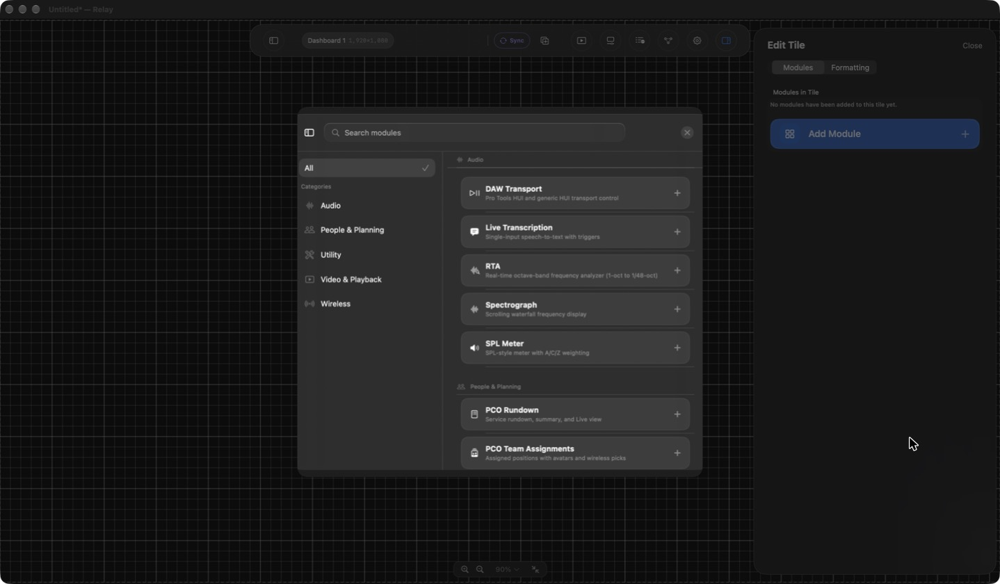

# Relay

Relay is a free, native dashboard and automation app for production teams. Bring show controls, device status, audio tools, and automation together on a canvas you can arrange for your workflow.

This repository starts the community edition from the free-version source snapshot. Every feature previously gated by Relay Pro is unlocked. No purchase, license key, or Relay Account is required. We are looking for contributors and future maintainers who want to help carry the project forward.

**Status:** development source for Relay 2.0, not a published, signed release. macOS is the primary supported development target. Relay Mobile is experimental and currently has known build failures.

## What Relay does



- Custom dashboard layouts with live controls and status tiles.
- Visual automation graphs, shared values, and universal automation.
- Integrations for ProPresenter, Resolume, audio consoles, wireless systems, MIDI/DAW transport, and NDI video.
- Audio analysis, transcription, roster tools, and local-network dashboard sharing.
- Optional Preview features for newer integrations and automation capabilities.

Availability depends on connected hardware, platform support, and any separately licensed vendor software. Debug builds enable Preview features automatically; shipping builds default Preview off. Change it in **Settings → Preview**, then restart Relay.

## Build on macOS

Use a Mac with Xcode 26.3 or newer and its command-line tools selected. Some project/helper configurations target newer macOS SDK versions; check the deployment targets in Xcode if your toolchain reports a platform mismatch.

```sh
git clone https://github.com/dbullard/Relay.git
cd Relay
open Relay.xcodeproj
```

Choose **Relay (DEBUG)**, select **My Mac**, and choose your own signing team if running through Xcode. No maintainer credentials or hosted backend are needed for the basic app. Xcode resolves Sparkle and Sentry through Swift Package Manager; the shared package lockfile is committed.

For an unsigned local build:

```sh
xcodebuild build -project Relay.xcodeproj -scheme 'Relay (DEBUG)' \
  -destination 'platform=macOS' \
  CODE_SIGN_IDENTITY='-' CODE_SIGNING_REQUIRED=NO CODE_SIGNING_ALLOWED=NO
```

Run the macOS tests:

```sh
xcodebuild test -project Relay.xcodeproj -scheme Relay \
  -destination 'platform=macOS' \
  CODE_SIGN_IDENTITY='-' CODE_SIGNING_REQUIRED=NO CODE_SIGNING_ALLOWED=NO \
  -parallel-testing-enabled NO
```

The test suite includes integration fixtures that use shared preferences; serial execution avoids known interference between parallel test processes. Ad-hoc/unsigned development builds may not support every capability that needs Apple signing or permissions. They are not distributable releases.

See [development setup](docs/DEVELOPMENT.md) for optional configuration and NDI runtime setup. Planning Center, YouTube, and other integrations that need API keys or tokens use your own accounts; see [docs/INTEGRATIONS.md](docs/INTEGRATIONS.md).

## Reporting bugs and contributing

- [Report a bug](https://github.com/dbullard/Relay/issues/new/choose) with your app version, macOS version, reproduction steps, and expected behavior.
- [Request a feature](https://github.com/dbullard/Relay/issues/new/choose), especially if you can help test or implement it.
- Read [CONTRIBUTING.md](CONTRIBUTING.md) before submitting a pull request.
- Read [SECURITY.md](SECURITY.md) for sensitive reports. Do not put credentials, customer logs, private dashboards, or personal information in public issues.

You can contribute code, documentation, hardware testing, or issue triage. We do not promise response times or support for every device. Maintainer access will grow through sustained contributions and review, rather than being granted automatically.

## Privacy and optional services

Community builds contain no production Sentry DSN, YouTube OAuth credentials, update feed, or maintainer backend configuration. Relay Account sign-in is disabled by default. Local diagnostic logs and export remain available.

The Sentry integration is limited to opt-in crash reports and explicitly submitted user feedback. It does not forward custom breadcrumbs, ordinary handled errors, hang reports, or runtime usage context. Manual Sentry submissions require a configured DSN; without one, use GitHub Issues or exported diagnostics. The existing optional usage-reporting code is retained, but no hosted backend is supplied in this repository.

## License and third-party components

Relay-owned source is licensed under the [MIT License](LICENSE). Third-party files retain their own licenses; see [THIRD_PARTY_NOTICES.md](THIRD_PARTY_NOTICES.md).

The proprietary NDI runtime is **not included** and is not relicensed by this project. The NDI headers retain their MIT notices. NDI functionality requires a separately installed runtime and compliance with NDI's terms. This repository does not include customer logs, private sample dashboards, the original Git history, or signing credentials.

Forks should clearly identify themselves and avoid suggesting that their releases are official Relay releases.
