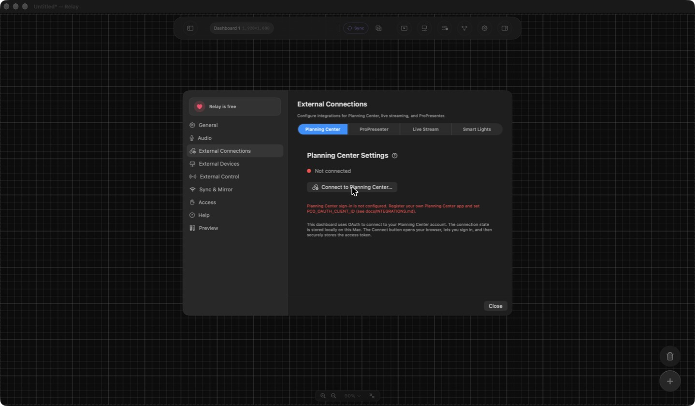

# Integrations that need your own credentials

Relay does not ship any API keys, OAuth clients, or hosted-service settings. Everything below uses **your own** accounts, so nothing in a build is tied to the original maintainer. Unconfigured integrations simply show a "not configured" message; the rest of the app is unaffected.

Build-time values go in `Config/Local.xcconfig` (gitignored). Copy it from the example first:

```sh
cp Config/Local.xcconfig.example Config/Local.xcconfig
```

In xcconfig files, write URL slashes as `https:/$()/example.com`, because `//` starts a comment. Rebuild after changing values. Never commit `Local.xcconfig` or paste secrets into issues.

| Integration | Needs | Where it is set |
|---|---|---|
| [Planning Center](#planning-center-pco) | Your own PCO OAuth app | `PCO_OAUTH_CLIENT_ID` in `Local.xcconfig` |
| [YouTube Stream Monitor](#youtube-stream-monitor) | Your own Google OAuth client | `YOUTUBE_OAUTH_*` in `Local.xcconfig` |
| [Sentry crash reports](#sentry-optional) | Your own Sentry project (optional) | `SENTRY_DSN` in `Local.xcconfig` |
| [Sparkle updates](#sparkle-updates-optional) | Your own appcast and signing key (optional) | `SUFeedURL` in `Local.xcconfig` |
| [Hue and Govee smart lights](#smart-lights) | A Hue bridge, or a Govee API key | Entered in the app |
| [NDI](#ndi) | The NDI runtime | See [DEVELOPMENT.md](DEVELOPMENT.md#ndi-runtime) |

Hardware integrations (ProPresenter, Resolume, audio consoles, wireless systems, MIDI) need no keys. You enter the device address in the app.

## Planning Center (PCO)

Relay signs in with OAuth (PKCE), so no client secret is needed.

1. Sign in to the [Planning Center developer portal](https://api.planningcenteronline.com/oauth/applications) and create a **new OAuth application**.
2. Set the **Redirect URI** to exactly: `app.relay.pco://oauth/callback`
3. Copy the application's **Client ID** (the Client Secret is not used).
4. In `Config/Local.xcconfig`, set:

   ```
   PCO_OAUTH_CLIENT_ID = your_client_id
   ```

5. Rebuild, then open **Settings → External Connections → Planning Center** and choose **Connect…**.

The scopes requested are `services` and `people`. Your Planning Center account needs access to those products. The access token is stored in your macOS Keychain, not in the repository.

If you skip this, **Connect…** shows: "Planning Center sign-in is not configured".



## YouTube Stream Monitor

This module is only available in Debug builds (`Relay (DEBUG)`) and builds whose distribution channel is `beta`. Release builds hide it.

1. In the [Google Cloud console](https://console.cloud.google.com/), create a project and enable the **YouTube Data API v3**.
2. Configure the OAuth consent screen. While the app is in "Testing" status, add your own Google account as a test user.
3. Create an **OAuth client ID** for your platform. The scope Relay requests is read-only: `https://www.googleapis.com/auth/youtube.readonly`.
4. In `Config/Local.xcconfig`, set the values that apply (macOS shown):

   ```
   YOUTUBE_OAUTH_CLIENT_ID_MACOS = your_client_id
   YOUTUBE_OAUTH_CLIENT_SECRET_MACOS = your_client_secret_if_your_client_type_has_one
   YOUTUBE_OAUTH_REDIRECT_URI_MACOS = your_registered_redirect_uri
   ```

   The default redirect is `app.relay.youtube:/oauth2redirect`, and that scheme is declared in `Relay-Info.plist`. If you register a different redirect, its URL scheme must also be added to the app's URL Types.
5. Rebuild, then open **Settings → External Connections → Live Stream** and choose **Connect YouTube…**.

iOS uses the matching `YOUTUBE_OAUTH_CLIENT_ID_IOS`, `YOUTUBE_OAUTH_REDIRECT_URI_IOS`, and `YOUTUBE_OAUTH_CALLBACK_SCHEME` keys. Relay Mobile is experimental and does not currently build.

## Sentry (optional)

Crash reporting is off unless you set your own DSN, and it is also disabled in Debug builds. Set `SENTRY_DSN` to a DSN from **your own** Sentry project. Reports then go to your project only. See [DEVELOPMENT.md](DEVELOPMENT.md) for what is and is not collected.

## Sparkle updates (optional)

Automatic updates are off unless `SUFeedURL` points at an appcast you host. To ship your own updates:

1. Generate your own EdDSA key pair with Sparkle's `generate_keys` tool.
2. Replace `SUPublicEDKey` in `Relay-Info.plist` with **your** public key. The value in the repository belongs to the original project, so updates signed with your key will not verify against it.
3. Set `SUFeedURL` in `Local.xcconfig` and publish a signed appcast.

Keep your private key out of the repository.

## Smart lights

- **Philips Hue:** no key to obtain ahead of time. In Relay, press the link button on your Hue bridge, then pair. Relay talks to the bridge over your local network.
- **Govee:** create an API key in the Govee Developer settings, then enter it in Relay's Settings → External Connections → Smart Lights. It is stored in your Keychain.

## NDI

NDI needs the separately licensed runtime. See [NDI runtime](DEVELOPMENT.md#ndi-runtime).

## Troubleshooting

- **A field in the app says "not configured":** the matching value is blank, or you did not rebuild after editing `Local.xcconfig`. Check `Config/Local.xcconfig` is in the `Config/` folder and has no stray spaces or quotes.
- **OAuth sign-in opens a browser and then fails to return:** the redirect URI registered with the provider must match the one above exactly.
- **Switching OAuth apps:** disconnect in Settings and connect again, because saved tokens belong to the app that issued them.
