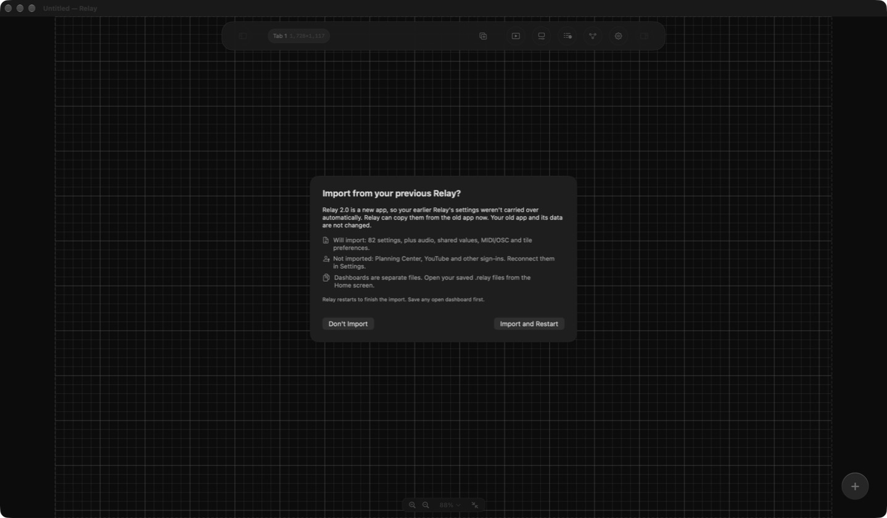

# Moving from Relay 1.3 or 1.3.1

Relay 2.0 is a new app: it has its own identifier (`app.relay.Relay`), so macOS keeps its settings separate from the earlier Relay (`davidbullard.relay`). Your old app is never changed, and nothing is lost. This page walks through moving over.

**You don't need to pay for anything.** Every feature is unlocked, and if you had a Relay Pro subscription you won't be charged again.

## What to expect

| | Carries over | Needs one step |
|---|---|---|
| Settings, external devices, audio and transcription inputs, shared values, MIDI/OSC/ProPresenter/Resolume/smart light settings, dashboard preferences | Yes, through the import | Run the import (below) |
| Saved dashboards (`.relay` files) | Yes, they are ordinary files | Open them from the Home screen |
| Planning Center, YouTube, and other sign-ins | No | Reconnect |
| Sennheiser Spectera trusted certificates | No | Trust them again when prompted |
| Linked-computer pairings (Sync & Mirror) | No | Pair again |
| Accounts, licenses, subscriptions | Not used any more | Nothing |

## Steps

1. **Download Relay 2.** Get the latest zip from [Releases](https://github.com/dbullard/Relay/releases/latest) and drag **Relay** to **Applications**. If macOS asks to replace your old Relay, either answer works: the import reads your saved settings, not the old app. If you'd rather keep both for a while, rename the old one first (for example `Relay 1.3`).
2. **Quit the old Relay.** Both versions listen for devices and linked computers on the same network ports, so don't run them at the same time.
3. **Open Relay 2.** On first launch it asks **Import from your previous Relay?**. Choose **Import and Restart**.

   

   Save any open dashboard first, because Relay restarts to finish. If you chose **Don't Import**, or want to import again later, use `Relay > Settings` → **General** → **Import from Previous Relay…**. Importing again replaces matching settings in the new app.
4. **Reconnect your services.** `Relay > Settings` → **External Connections** → **Planning Center** → **Connect…**. Reconnect any other sign-ins the same way, and re-enter any device passwords that don't appear.
5. **Open your dashboards.** On the Home screen, choose **Open File…** and pick your saved `.relay` files. Set your startup file again if you used one.
6. **Check your devices.** Open `Relay > Settings` → **External Devices** and confirm your consoles, wireless units, and other gear show as connected. Pair your linked computers again under **Sync & Mirror**.
7. **Retire the old app** when you're happy. You can delete it. Relay 1.3.1 shows a one-time notice pointing here, and its update feed won't change again.

## Troubleshooting

**The import prompt didn't appear.**
Open `Relay > Settings` → **General**. If **Previous Relay** is missing, Relay couldn't find the old settings file (`~/Library/Preferences/davidbullard.relay.plist`). That means the earlier Relay was never run on this Mac or its settings were deleted.

**"Check for Updates" beeps and nothing happens (Relay 2.0 or 2.0.1).**
Those versions couldn't quit for an update while the Home screen was open. Choose **New Dashboard** on the Home screen, then run `Relay > Check for Updates…` again. Version 2.0.2 and later fix this.

**Planning Center says "not configured".**
You're running a source build. Enter your own client ID in **Settings → Integrations**, or install the official release.

**A device isn't listed after importing.**
Scan for it in `Relay > Settings` → **External Devices**, or add it manually.

Still stuck? [Open an issue](https://github.com/dbullard/Relay/issues/new/choose).
