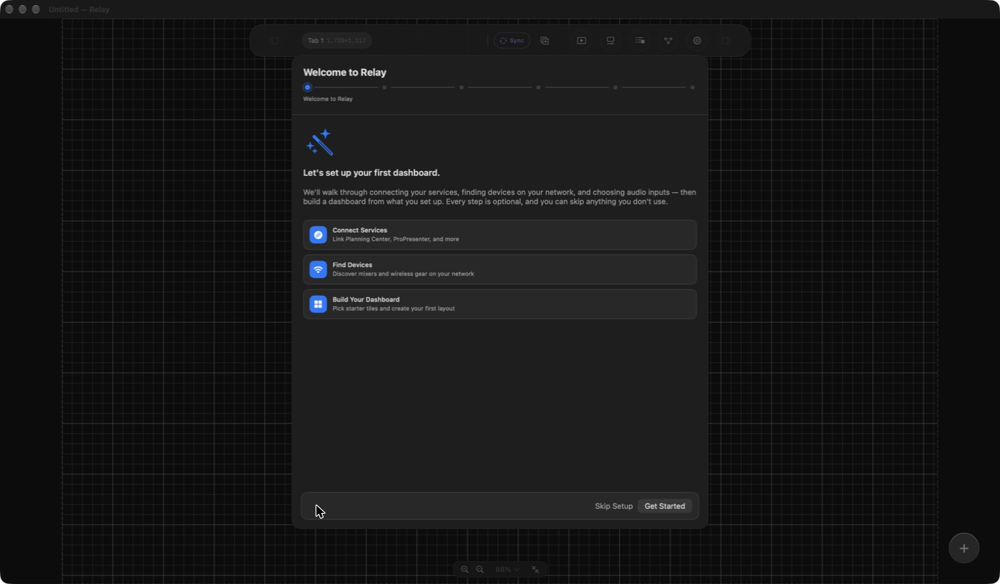
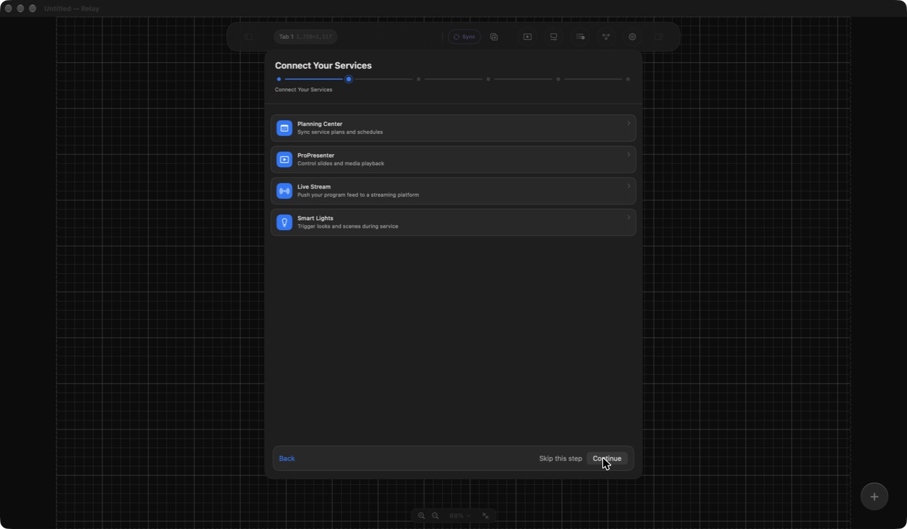
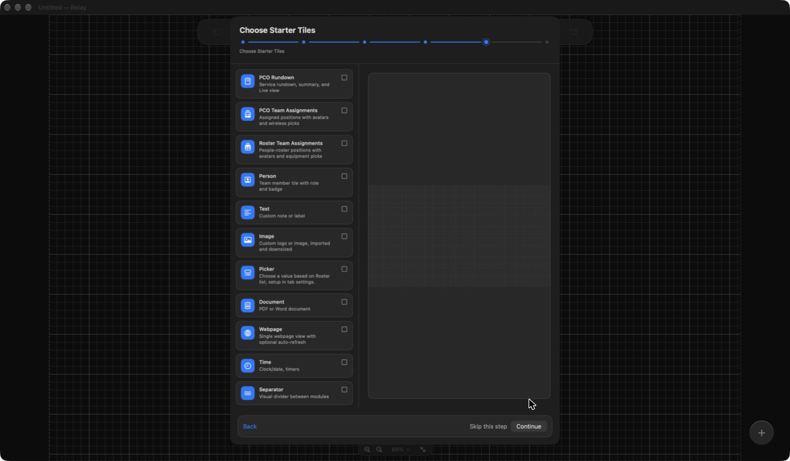

# Setup Wizard: guided first-run setup for Relay

Walk through connecting services, finding devices, choosing starter tiles, and creating your first dashboard.

The Setup Wizard walks you through connecting your services, finding devices, setting up audio inputs, choosing starter tiles, and creating a first dashboard from what you set up. Every step is optional, so you can skip anything you don't use.

## Open the wizard

Choose `File > Setup Wizard…`. You can run it again at any time, for example after you add new devices or services.

## The steps

#### Step 1: Welcome

The first screen previews what the wizard covers: connecting services, finding devices on your network, choosing audio inputs, and building your first layout. Choose `Get Started` to begin, or `Skip Setup` to close the wizard.

#### Step 2: Connect your services

Link the services you use: Planning Center (service plans and schedules), ProPresenter (slides and media playback), Live Stream, and Smart Lights.

Planning Center sign-in needs your own Planning Center app, and Live Stream needs your own Google OAuth client. See [Integrations that need your own credentials](../../INTEGRATIONS.md). Choose `Skip this step` for anything you don't use.

#### Step 3: Find your devices

Relay scans your local network for audio consoles and wireless gear and lists what it finds. Choose `Add` next to a device to add it, or skip the step and add devices later under [Integrations](../integrations/overview.md).

#### Step 4: Set up audio inputs

Choose the audio inputs Relay should use for level measurement and for transcription, and optionally pick a folder for SPL logging. See [Audio and video modules](../dashboards/modules/audio-visual.md).

#### Step 5: Choose starter tiles

Tick the tiles you want, such as PCO Rundown, PCO Team Assignments, Roster Team Assignments, Person, Text, Image, Picker, Document, Webpage, Time, or Separator. A live layout preview on the right updates as you choose, so you can see how the tiles will sit on the canvas before you continue.

#### Step 6: Review and create your dashboard

Name your dashboard (the default is "Dashboard 1"), review the tiles, and choose `Create Dashboard`. Wireless devices Relay knows about are listed here as wireless mic and IEM status tiles, each with its own checkbox, so you can leave out any you don't want.

Use `Back` on any step to change an earlier choice.

## After the wizard

- Fine-tune your layout with [Tiles](../dashboards/tiles.md).
- Add more [modules](../dashboards/modules.md) as your needs grow.
- Review [Core concepts](../core-concepts.md) if any terms are new.
- If a device wasn't found, add it manually under [Integrations](../integrations/overview.md).
